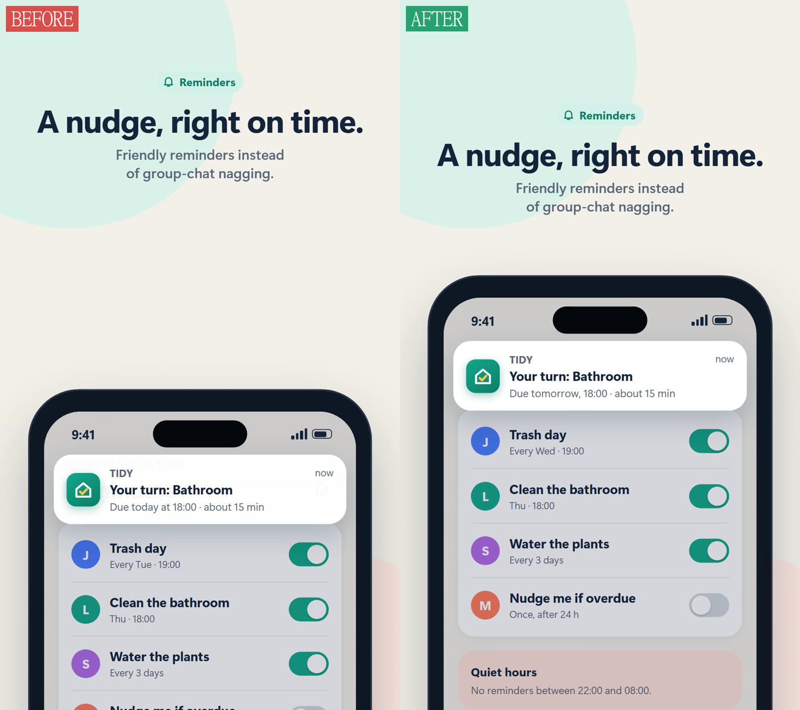
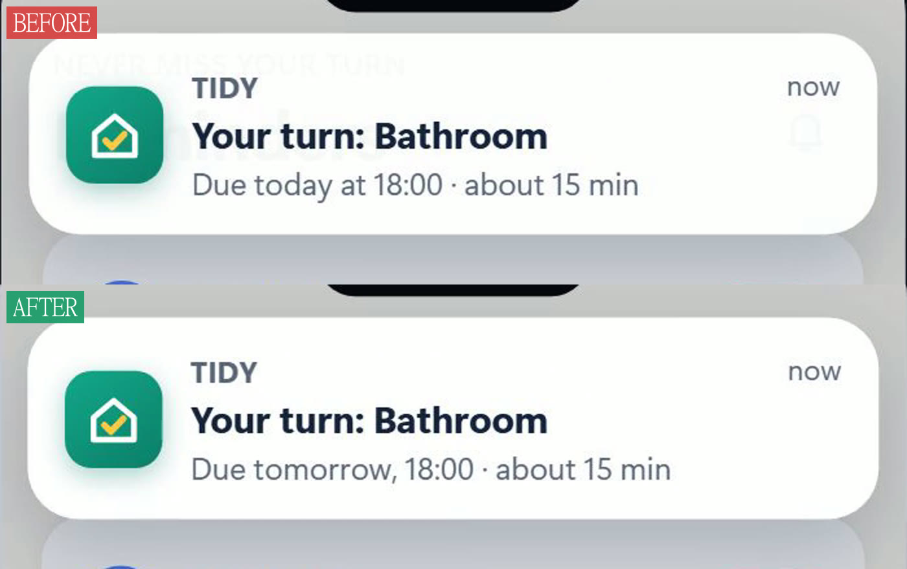
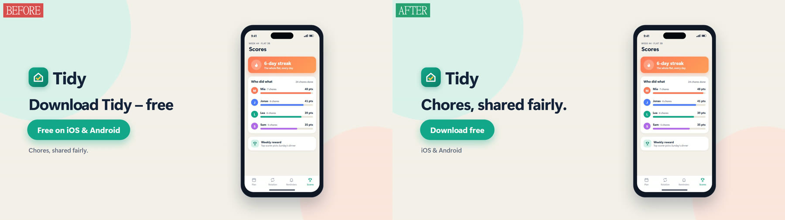
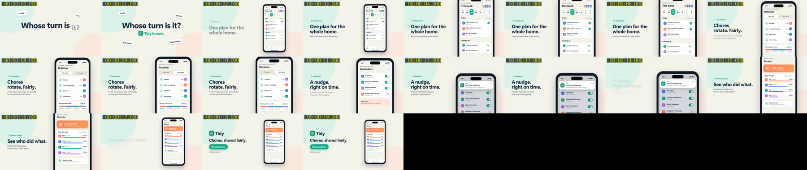

# remotion-video-check

An agent skill for Claude Code and other agents that read `SKILL.md` that
checks Remotion videos **after rendering**: it looks at the frames, fixes
what is wrong and checks again.

Most Remotion skills teach an agent how to *write* compositions. This one
makes sure the result is actually good before anyone sees it.

## What it does

- **Measures** with ffmpeg, so you don't rely on looks alone:
  - stretches where nothing visibly changes
  - whether the hook moves in the first 0.5 s
  - black frames, audio peak, duration and size
  - renders older than the source
- **Shows** the video as a 1-fps contact sheet, as frame strips (4 fps, or 30 fps
  to see easing) and as full frames, so the agent really looks at it.
- **Lints** the source before rendering:
  - `interpolate` without clamping
  - CSS animations
  - `Math.random`, `Date.now` and timers
  - hard-coded fps
  - raw ``, `<video>` and `<audio>` tags
- **Checklist** of the things that make promo videos look cheap: dead pauses,
  weak or restless zooms, faded device mockups, double highlights, overlays
  repeating the screen, lone decorative lines, unreadable text, personal
  data, unmarked claims.
- **Fix loop:** the agent fixes craft issues itself and asks you about content
  decisions. It re-renders, re-checks the same timestamps, and keeps a
  `findings.json` per video so regressions show up. It stops after three
  rounds per issue.

## Example: before and after

The test was set up to be fair:

1. **Before:** A fresh agent was given an ordinary request: "build a ~20 s
   promo for a fictional chores app, in 16:9 and 9:16, with a phone mockup,
   zooms and a CTA". It had no knowledge of this skill, and it was told not
   to use any skills.
2. **After:** A second fresh agent got an identical copy of that finished
   project and ran this skill on it, with no other hints.

Across both formats the skill found **12 issues in 3 rounds**. Ten were
fixed, one is a wording decision the skill would normally leave to you, and
one was judged intentional. The log of the 16:9 version is in
[`docs/example-findings.json`](docs/example-findings.json).



In the 9:16 version above, three things were wrong:
- When the camera zoomed onto the notification, the phone slid down and left
  a ~550 px gap under the headline.
- The kicker sat inside the top 14 % that TikTok and Reels cover.
- Text from the screen behind showed through the notification.



Here is the notification up close. The banner was only 97 % opaque. And the
story contradicted itself: it said "Due today", but the plan has the bathroom
on Thursday.



The end card said "Tidy" and "free" twice each, and the button ("Free on iOS
& Android") wasn't an action. The skill made one clear CTA out of it, and
marked the new wording `ask-user`, because copy is your call.

Other findings:

| Finding | Fix |
|---|---|
| The camera zoomed fully in and out around every screen change ("zoom pumping") | One continuous camera: in once, pan between focus points, out once before the CTA |
| The notification vanished in a single frame instead of sliding out with its screen (only visible in a 30 fps strip) | Rendered in the layer of its screen |
| The phone stood still without a headline for 0.4 s right after the hook | Headline starts earlier |
| The leaderboard zoom was too weak, with 18 px text | Stronger zoom |
| Lint: `interpolate` without clamp | Clamped, except where the spring overshoot is wanted |

This is what the agent looks at first, the 1-fps contact sheet:



## Install

You need `ffmpeg` and `ffprobe` on PATH and Node 18+. No npm packages are
needed.

For all your projects:

```bash
git clone https://github.com/Felipe3052/remotion-video-check ~/.claude/skills/remotion-video-check
```

For one project only, shared with your team via git:

```bash
git clone https://github.com/Felipe3052/remotion-video-check .claude/skills/remotion-video-check
rm -rf .claude/skills/remotion-video-check/.git
```

Update a global install with `git -C ~/.claude/skills/remotion-video-check pull`.

Optional: add `.claude/video-check-rules.md` to your project with your own rules,
such as brand spelling, allowed app stores, privacy, wording or claims. The
skill reads it and puts it before its defaults.

## Use

The skill triggers by itself after a render, or when you ask "check the video".
You can also run the scripts by hand:

```bash
node ~/.claude/skills/remotion-video-check/scripts/lint-remotion.mjs src
node ~/.claude/skills/remotion-video-check/scripts/qa-video.mjs out/video.mp4 --at=3,12.5 --strip=10-14 --strip-fps=30
```

Results land in `out/_qa/<name>/`. Add `out/` to `.gitignore`.

| Option | Meaning |
|---|---|
| `--at=s,s` | full-resolution frames at these seconds |
| `--strip=a-b` | frame strip of a time range (several ranges separated by commas) |
| `--strip-fps=n` | strip frame rate, default 4; 30 shows stutter and easing |
| `--freeze=s` | shortest static stretch to report, default 1.5 |
| `--hook=s` | first motion must happen within s seconds, default 0.5 |
| `--src=dir` | warn if a file in these folders is newer than the video, default `src` |
| `--out=dir` | output folder, default `out/_qa` |

The lint exits with code 1 when it finds something, so you can use it in a
pre-render script or CI. Its warnings are heuristics; judge each one.

## Works well with

- [remotion-music-finder](https://github.com/Felipe3052/remotion-music-finder): finds licensed background music that fits the video (coming soon).
- The official Remotion skills ([remotion-dev/skills](https://github.com/remotion-dev/skills))
  for writing compositions. This skill takes over once there is a render.

## Contributing

Issues and pull requests are welcome, especially new checklist items from
your own renders ("this went wrong and the skill didn't catch it").

## License

MIT, see `LICENSE`.
